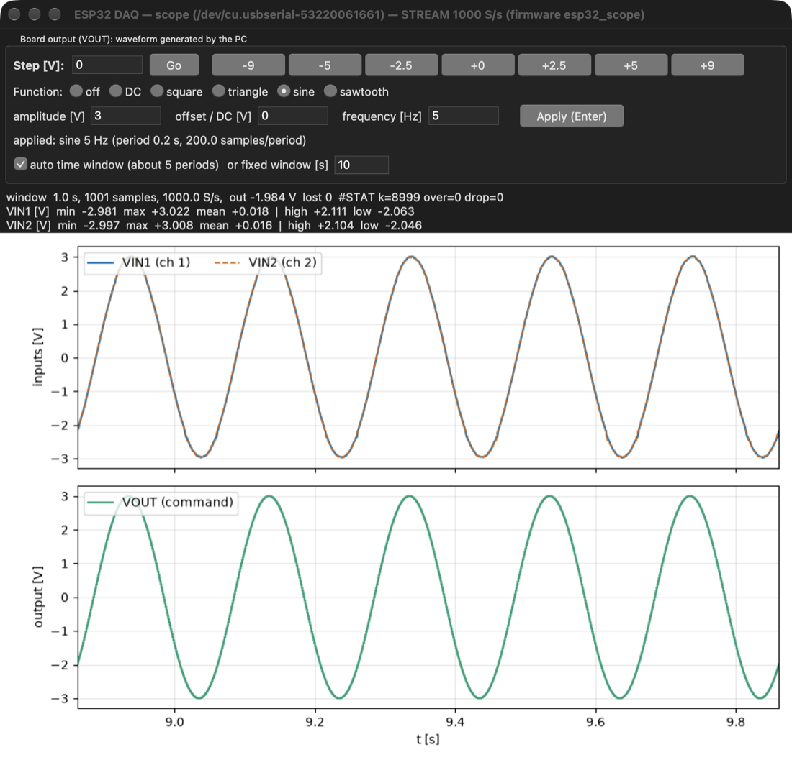

# ESP32 DAQ

Firmware and HMI for acquisition and control with the ESP32: 2 inputs and 1 output of ±10 V.

**Documentation: <https://helonayala.github.io/esp32_daq/>**

## HMI: scope and signal generator (firmware `esp32_scope` + `hmi/scope.py`)



*Figure generated with the output wired to both inputs (VOUT → VIN1 and VIN2), only as a test.*

`firmware/esp32_scope/` turns the board into a 2-channel scope with a waveform generator on VOUT (off, DC, square, triangle, sine, sawtooth).
The ESP32 generates the waveform and samples VIN1/VIN2 **by itself** at a fixed rate (1000 S/s by default, up to ~1400 S/s) and sends the data to the PC in bursts every 20 ms.
Sample *k* is at time *k/FS*, so USB and PC jitter do not affect the time axis.

```bash
./flash.sh <port>                                    # firmware/esp32_daq (control)
SK=firmware/esp32_scope ./flash.sh <port>            # firmware/esp32_scope (scope / generator)
python hmi/scope.py --port <port>                    # GUI (needs Python with Tk >= 8.6; see below)
python hmi/scope_cli.py --port <port> --steps 0,1,-1,5,-5 --dwell 3    # terminal: DC steps and a table of VIN1/VIN2 errors
```

- **The HMI of your project must be built from `hmi/scope.py`** (serial protocol, stream thread, window, controls).
- **Do not change the acquisition and output-filter parameters**: `ADC_N`, `EDGE_TAU_US`, `EDGE_TARGET_US`, `PWM_BITS` in `esp32_scope.ino`, the calibration in `cal_board.h`, nor the command-line values `--tau/--target/--bits`. They are already tuned for the board (see below).
- Protocol (115200 baud at boot, the HMI raises it to 460800 with `B<baud>`): `M<fs>` start streaming, `W<shape>,<amp mV>,<off mV>,<freq mHz>` waveform, `K` keep-alive (the output goes to 0 V if the PC is silent for 2 s), `V<mV>` static output, `R` read, `S` stop. Stream lines: `#S<k>,<vin1 mV>,<vin2 mV>,<vout mV>`. Header of `esp32_scope.ino` has the full list.
- **Parameters (already set):** the output filter (2 RC, ~2 ms per pole) limits the bandwidth (at 20 Hz the sine loses ~7 % and lags ~26°). The firmware has an optional edge pre-emphasis (`E<tau>,<target>`: inverts the filter with tau ≈ 2000 µs and replaces it by a faster one) and a PWM resolution option (`Q<bits>`); both are off by default and can be set only through the constants above.
- ADC: each sample is the mean of 6 readings without the minimum and the maximum (removes single-sample glitches).
- The Apple system Python (Tk 8.5) opens a blank window on recent macOS: use `brew install python@3.12 python-tk@3.12` and create the venv with it.
- `scope.py` detects the firmware: with the old `esp32_daq` firmware it falls back to polling with `R`/`V` (about 200 S/s). Going back to the previous firmware is just flashing `firmware/esp32_daq` again.
